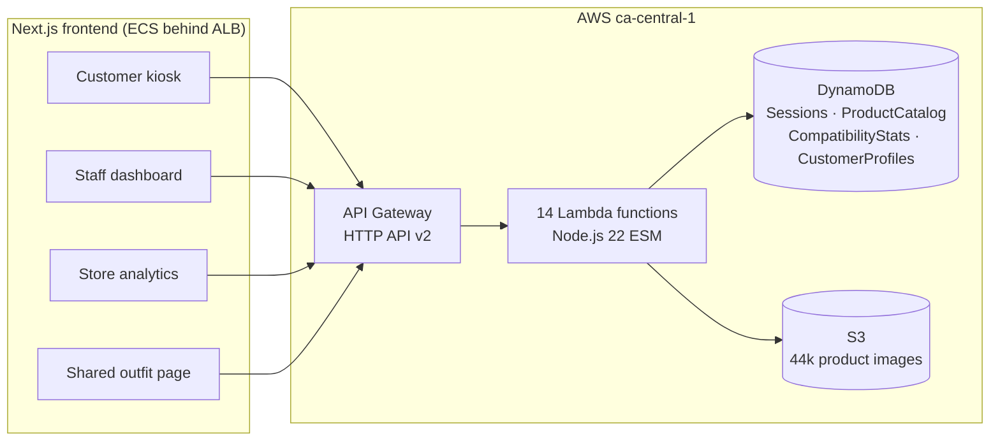

# Vestia: The Retail Experience Platform

**Smart fitting room kiosks that connect shoppers, store staff and store analytics in real time.**


McMaster University · COMPSCI 4ZP6A/B Capstone · Team 27

---

## Overview

In a Vestia fitting room, a shopper scans the items they brought in at a kiosk. Vestia then:

- **Recommends complete outfits** using an 8-signal scoring engine over a **44,446-product** catalog
- **Lets the shopper request a different size or colour**, which appears instantly on the staff dashboard (`QUEUED → CLAIMED → DELIVERED`)
- **Personalises results** from a loyalty profile and live thumbs-up/down feedback
- **Saves and shares outfits** with a 6-character code and a mobile-friendly link
- **Gives store owners analytics** on sessions, scans, requests and fulfilment rates

🎬 **Demo video:** [`FinalSubmission/Vestia_FinalDemo.mp4`](./FinalSubmission/Vestia_FinalDemo.mp4)

---

## Live demo

| Interface | URL |
|---|---|
| Customer kiosk | http://vestia-alb-260109529.ca-central-1.elb.amazonaws.com/ |
| Staff dashboard | http://vestia-alb-260109529.ca-central-1.elb.amazonaws.com/admin |
| Store analytics | http://vestia-alb-260109529.ca-central-1.elb.amazonaws.com/analytics |

<details>
<summary><b>Quick walkthrough (2 minutes)</b></summary>

1. **Open the kiosk** and scan a SKU. These items combine into a full outfit:

   | SKU | Item | Category |
   |---|---|---|
   | `10005` | Nike Men's Blue Sports T-Shirt | Top |
   | `10020` | Nike Men's Reversible Shorts | Bottom |
   | `1917` | Puma Men's White Sneakers | Shoes |
   | `8302` | Reebok Men's Premier Sports Shoes | Shoes |

2. **Sign in** with `demo@vestia.com` to turn on personalised recommendations (8 past purchases; sizes Top M / Bottom 32 / Shoes 10; prefers black, navy and grey). Guest mode works too.
3. **Explore:** open an item's recommendations, try **Mix & Match**, **Request Size/Colour**, and **Save Outfit** for a share link and QR code. End the session to leave feedback.
4. **Open the staff dashboard** in a second tab and claim and deliver the request in real time.
5. **Open analytics** for store-wide metrics over 7, 30 or 90 days.

</details>

---

## Architecture



- **Frontend:** Next.js 16, React 19, TypeScript 5 and Tailwind CSS 4, containerised and deployed to ECS behind an Application Load Balancer. A typed `VestiaAPI` client in `frontend/src/lib/api.ts` wraps every endpoint.
- **Backend:** 14 serverless Lambda functions behind API Gateway, one per resource (session, request, product, recommend, outfit, customer, analytics).
- **Data:** an event-sourced single-table design in `VestiaSessions` (scans, requests, feedback, preferences, outfits), plus the product catalog, co-occurrence statistics and customer profiles.
- **CI/CD:** a GitHub Actions workflow redeploys changed Lambdas on every push.

Full endpoint list, table schemas and access patterns: **[AWS_ARCHITECTURE.md](./AWS_ARCHITECTURE.md)**

### Recommendation engine

Each candidate product gets a deterministic weighted score across **8 signals**: article-type compatibility, colour compatibility, pattern compatibility, historical co-occurrence, fabric compatibility, price proximity, customer preference and live session feedback. The preference signal's weight rises from **5% to 33%** when a customer profile or in-session preferences are available. Mix & Match scores candidates against several scanned items at once and fills in the missing categories (top, bottom, shoes, accessory).

---

## Testing and verification

All tests ran against the **live AWS deployment** (2 warm-up calls, then 10 measured runs per endpoint, with P95 taken from the warm runs).

| Result | Detail |
|---|---|
| **17 / 20** test cases passed | All functional tests passed in all 11 components |
| Recommendation quality | **Precision@1 = 1.00**, Precision@3 = 0.97, Precision@5 = 0.85 against curated compatibility rules |
| Session API latency | Scan write P95 **277 ms** (target < 300 ms); session read P95 **98 ms** (target < 500 ms) |
| Known gap | Recommendation P95 ≈ 1.5 s against a 1 s target, caused by a full catalog scan over 44,446 products at scoring time |

Full report: **[VnV_Test_Results/VnV_Test_Results.md](./VnV_Test_Results/VnV_Test_Results.md)** · Test runner: [`test-runner.mjs`](./VnV_Test_Results/test-runner.mjs) · Raw results: [`test-results.json`](./VnV_Test_Results/test-results.json)

---

## Run locally

**Prerequisites:** Node.js 18+ and npm. The frontend talks to the deployed AWS backend, so no backend setup or environment variables are needed.

```bash
git clone https://github.com/saagarracharla/Vestia_The-Retail-Experience-Platform_RXM.git
cd Vestia_The-Retail-Experience-Platform_RXM/frontend
npm install
npm run dev
```

| Route | Interface |
|---|---|
| `localhost:3000` | Kiosk welcome screen |
| `localhost:3000/kiosk/session` | Active fitting-room session |
| `localhost:3000/admin` | Staff request dashboard |
| `localhost:3000/analytics` | Store analytics |
| `localhost:3000/outfit/{shareCode}` | Shared outfit view |

### Development commands

```bash
cd frontend && npx tsc --noEmit        # type-check

# deploy a single Lambda manually (CI does this automatically on push)
cd backend/lambdas/vestia-recommend
zip -q function.zip index.mjs
aws lambda update-function-code --function-name vestia-recommend \
  --zip-file fileb://function.zip --region ca-central-1
```

---

## Repository structure

```
├── frontend/              Next.js app: kiosk, staff dashboard, analytics, shared outfits
│   └── src/{app,components,lib,utils}
├── backend/
│   ├── lambdas/           14 Lambda functions (one folder each)
│   ├── scripts/           Data pipeline: catalog enrichment, compatibility stats
│   └── context/           OpenAPI spec and product schema
├── VnV_Test_Results/      Live-system test runner, results and report
├── Documents/             SRS, design and V&V document, research, reflection
├── FinalSubmission/       Final report and demo video
├── AWS_ARCHITECTURE.md    Endpoints, DynamoDB schemas, access patterns
└── deploy.sh              Builds and deploys the frontend to ECS
```

---

## Documentation

| Document | Location |
|---|---|
| Software Requirements Specification | [`Documents/SRS_Project_plan_requirements.pdf`](./Documents/SRS_Project_plan_requirements.pdf) |
| Design and V&V document | [`Documents/VestiaDesignAndV&VDoc.pdf`](./Documents/VestiaDesignAndV&VDoc.pdf) |
| V&V test results | [`VnV_Test_Results/VnV_Test_Results.md`](./VnV_Test_Results/VnV_Test_Results.md) |
| Team reflection | [`Documents/Group_27_Reflection.md`](./Documents/Group_27_Reflection.md) |

---

## Team 27

Saagar Racharla ([@saagarracharla](https://github.com/saagarracharla)) · Rushit Shah ([@Rush-Shaw](https://github.com/Rush-Shaw)) · Partik Dev ([@devp2mc](https://github.com/devp2mc)) · Gurmandeep Johal ([@gjohal78](https://github.com/gjohal78)) · Manush Patel · Mahdi Mohammad · [@rastog1g](https://github.com/rastog1g)

*COMPSCI 4ZP6A/B, McMaster University*
